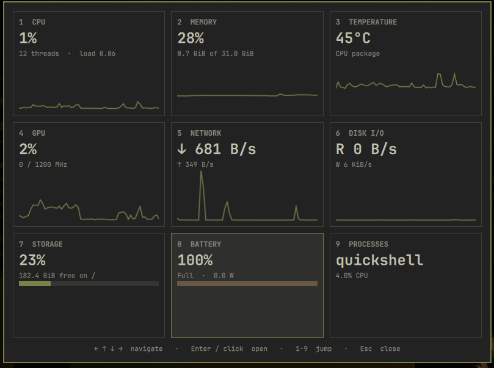
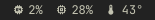
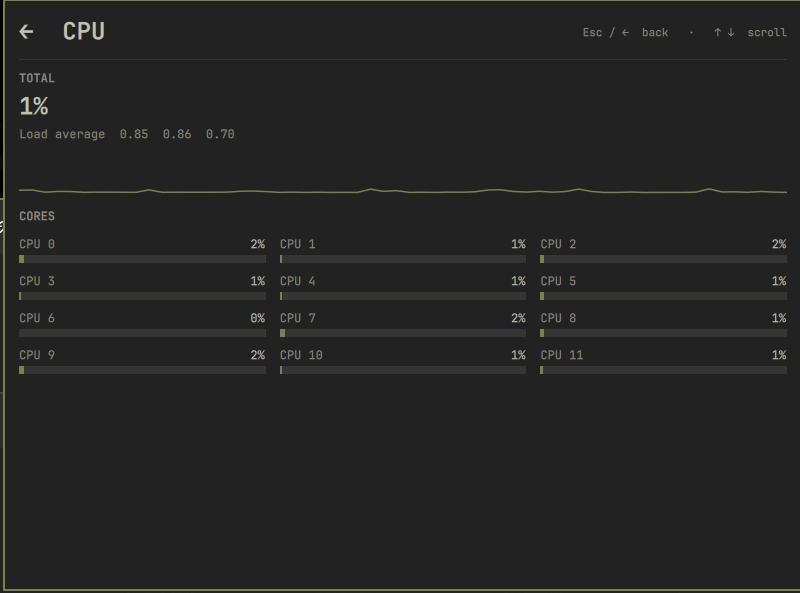
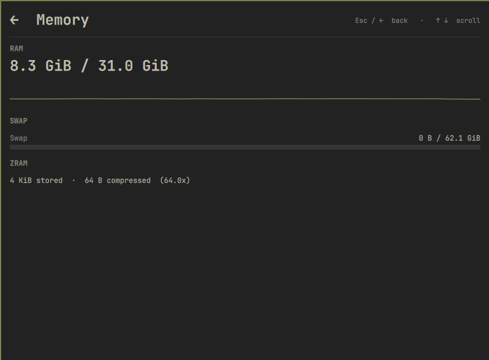

# Jarvis Monitor

System monitor plugin for the Omarchy shell. It shows CPU, memory and temperature in the top bar, and opens a panel with the full set of metrics for the machine.

No sudo or pkexec is required. No network access.



| Bar widget | CPU detail | Memory detail |
|---|---|---|
|  |  |  |

## What it shows

The bar widget displays CPU usage, memory usage and CPU temperature. The panel groups everything into nine categories, each with a summary card and a detail view:

| Category | Metrics |
|---|---|
| CPU | total usage, usage per thread, load average, history graph |
| Memory | RAM, swap, zram stored and compressed size, compression ratio |
| Temperature | CPU package temperature with history |
| GPU | estimated busy percentage and current frequency (Intel i915) |
| Network | download and upload totals with history, rates per interface |
| Disk I/O | read and write throughput and busy percentage per physical disk |
| Storage | used, free and total space per filesystem |
| Battery | charge, status and power draw in watts |
| Processes | top ten by CPU and top ten by memory |

Metrics that the hardware does not expose are shown as unavailable.

## Architecture

The plugin is a single `bar-widget` made of six files:

| File | Role |
|---|---|
| `manifest.json` | plugin metadata and entry point |
| `BarWidget.qml` | bar readout, IPC handler, host of the panel |
| `Collector.qml` | reads the system files on a timer and keeps a short in-memory history |
| `Panel.qml` | overview cards and detail views |
| `Model.js` | pure parsing and formatting functions |
| `Sparkline.qml` | small line graph |

Data flow: `Collector` reads the system files every interval, converts counters into rates from the difference between two samples, and appends to a fixed-length history (60 samples). `BarWidget` and `Panel` only read properties from the collector. All colors, fonts and spacing come from the shell theme tokens (`Color`, `Style`), so the panel follows theme changes.

Each bar surface creates its own widget instance, so on a multi-monitor setup there is one lightweight collector per monitor.

## Files read and processes started

The plugin reads only, and writes nothing outside memory.

Read continuously on every interval (default 2 seconds):

- `/proc/stat`, `/proc/meminfo`, `/proc/loadavg`
- `/proc/net/dev`, `/proc/diskstats`
- `/sys/block/zram0/mm_stat`
- the CPU temperature input under `/sys/class/hwmon` or `/sys/class/thermal`
- the battery `uevent` under `/sys/class/power_supply`
- the GPU frequency and RC6 counters under `/sys/class/drm`

Short-lived child processes:

- at startup, one `sh` call per run to locate the temperature sensor, the battery and the GPU card by name
- `df` every 15 seconds for filesystem usage
- `top` every 3 seconds, only while the panel is open, for the process lists

Middle click on the bar widget asks Omarchy to open `btop`, which must be available on the system.

The plugin does not collect, store or send data, and does not open any network connection.

## Install

```bash
omarchy plugin add https://github.com/FernandoTechSpace/jarvis-monitor-omarchy.git --enable
```

Plugins run inside the shell process without sandboxing. Review the code before enabling it.

For manual installation, clone the repository to `~/.config/omarchy/plugins/fernando.jarvis-monitor`, then run:

```bash
omarchy-shell shell rescanPlugins
omarchy plugin enable fernando.jarvis-monitor
```

## Use

| Action | Result |
|---|---|
| Click the bar widget | open or close the panel |
| Middle click the bar widget | open `btop` |
| Arrow keys or `h` `j` `k` `l` | move between cards |
| `Enter` or click a card | open its detail view |
| `1` to `9` | jump to a category |
| `Esc`, `b` or left arrow | go back, and close from the overview |
| Up and down arrows | scroll a long detail view |

To open the panel with a shortcut, bind the shell toggle in `~/.config/hypr/bindings.lua`:

```lua
o.bind("SUPER + ALT + M", "Jarvis Monitor", "omarchy-shell shell toggle fernando.jarvis-monitor '{}'")
```

The IPC target `fernando.jarvis-monitor` also accepts `open`, `close` and `toggle`.

## Configure

The refresh interval, in milliseconds, is set on the widget entry in `~/.config/omarchy/shell.json`:

```json
{ "id": "fernando.jarvis-monitor", "interval": 2000 }
```

## Update and remove

```bash
omarchy plugin update fernando.jarvis-monitor
omarchy plugin remove fernando.jarvis-monitor
```

## Requirements and limits

- Omarchy with the shell plugin system.
- GPU metrics rely on the Intel i915 sysfs interface. The busy value is estimated from the time the GPU is not in the RC6 power-down state, and the frequency reads 0 while it is idle.
- Battery power draw is current multiplied by voltage, or `power_now` when the firmware provides it.
- The process CPU percentage is per core, so 100 percent means one full core.

## Development

Edits through a symlink are not hot-reloaded. After changing a file, restart the shell:

```bash
omarchy-restart-shell
```

Validation:

```bash
omarchy plugin validate .
```

## License

MIT
